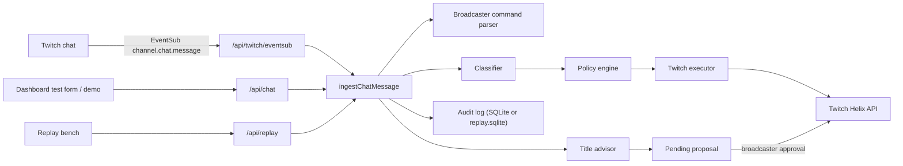

# Nachtschicht Architecture

Nachtschicht is a Twitch AI moderator whose product goal is to replace the staffed chat-moderation shift. It watches chat and acts like a real moderator (warn, delete, timeout, ban, chat modes), so a channel does not need humans continuously reading messages. Human authority remains for appeals, unbans, emergency control, and stream decisions. Stream title, category, and tags are only **proposed** by the AI and published after broadcaster approval.

## Product invariants

These rules define the product. Any change that breaks one is a bug, not a feature.

1. The AI never calls Twitch directly. The classifier returns a structured verdict; only the policy engine (`lib/policy.ts`) decides the action, and only `lib/twitch.ts` executes it.
2. Title, category, and tags are never published without broadcaster approval (dashboard button or `!aimod approve` from the broadcaster).
3. Protected roles (default: moderator, broadcaster) are never punished automatically; they are only flagged.
4. Shadow mode and the emergency stop hold every action. Held decisions are still logged.
5. Unbans are human-only (dashboard or broadcaster command). The AI must not silently undo its own bans.
6. Every decision is written to the audit log with reason, confidence, model version, and rule version.
7. Chat text is untrusted input. It must never be able to change settings, issue commands, or alter the system prompt. Only messages whose sender is verified as broadcaster by Twitch user ID or badge may run `!aimod` commands.

## Stack

- Next.js 15 (App Router) with React 19, single app, Node.js runtime for all API routes.
- SQLite via `better-sqlite3`, file `data/nachtschicht.sqlite` (git-ignored).
- `zod` for request validation, `vitest` for tests.
- `motion` for UI micro-interactions, `@modelcontextprotocol/sdk` for the read-only MCP endpoint.

## Data flow

The replay route binds `ingestChatMessage` to `data/replay.sqlite` through `runWithDatabase`. Shadow mode holds every action, so that run records the decision and does not call Helix.

## Module map

| Path | Responsibility |
| --- | --- |
| `lib/types.ts` | Shared domain types and enums (roles, risks, actions, settings, audit). |
| `lib/classifier.ts` | Turns a chat message into `Classification` (category, risk, confidence, reason). Currently heuristic (`heuristic-v2`). Identity slurs stay hate even when the message also contains an allowed term. |
| `lib/policy.ts` | Deterministic policy v3: moderation level plus streamer permissions map a verdict to an action. Also handles confidence thresholds, protected roles, shadow/emergency hold, escalation, and raid guard. |
| `lib/moderation.ts` | Orchestrates ingestion: classify, decide, execute, audit, title proposal. Builds the dashboard snapshot. |
| `lib/twitch.ts` | Twitch config, OAuth URL, action executor. |
| `lib/commands.ts` | Parses `!aimod <stop/start/shadow/live/approve/reject/unban login>`. |
| `lib/badges.ts` | Maps EventSub badges to `ChannelRole`. |
| `lib/eventsub.ts` | HMAC signature and timestamp check for EventSub webhooks. |
| `lib/crypto.ts` | AES-256-GCM encryption for stored OAuth tokens. |
| `lib/title-advisor.ts` | Detects topic shifts and creates title/category/tag proposals. |
| `lib/corpus.ts` | Labeled replay fixtures. `locked` cases are the current contract. `watch` cases record intended behavior the heuristic still misses. |
| `lib/replay.ts` | Runs the corpus through ingest on an isolated SQLite file in shadow mode. Refuses to reset the application database. |
| `lib/db.ts` | SQLite schema, migrations (`ensureColumn`), and all persistence. `runWithDatabase` binds a call to an explicit file. |
| `app/api/replay/route.ts` | Starts one replay against `data/replay.sqlite` and returns the report. |
| `lib/settings-input.ts` | Normalizes channel-setting edits: term lists, house rules, timeout bounds, and locked protected roles. |
| `app/api/*` | Thin route handlers: validate with zod, call `lib/*`, return JSON. |
| `lib/mcp.ts` | Read-only MCP server (status, audit, recent chat, pending proposal), bearer-token and origin checks, stateless Streamable HTTP handler. |
| `app/api/mcp/route.ts` | Thin MCP endpoint: disabled without `MCP_API_TOKEN`, rejects foreign origins and wrong tokens, then delegates to `handleMcpRequest`. |
| `app/layout.tsx`, `components/app-nav.tsx` | App shell: sidebar, type, and the desk / channel-settings navigation with an animated active marker. |
| `components/motion.tsx` | Micro-interactions on `motion/react`: `MotionProvider` (honors reduced motion), `Pressable`, `Switch`, `PulseDot`, `AnimatedValue`, `PopIn`. |
| `components/dashboard.tsx` | Live desk: moderation shortcuts, AI runtime status, timeout details, test chat, replay bench, stream shield, proposals, audit. |
| `app/settings/page.tsx`, `components/settings-form.tsx` | Streamer channel setup: shadow or live, emergency stop, moderation level, permission ceiling, house rules, word lists, and protected roles. |
| `docs/OVERVIEW.md` | Shareable introduction for streamers and collaborators. The build plan stays in this file. |
| `docs/DOCUMENTATION.md` | How to run, use, and check the desk. |
| `docs/MARKETING.md` | Who we sell to, price, and the shadow-to-paid sales path. |

## Classifier boundary

The classifier returns a structured verdict. It does not call Twitch, and it does not receive tools.

MCP is a protocol for exposing tools to a model. Wiring moderation through an MCP server would give the model delete, timeout, ban, and chat-settings tools. The model could then skip `lib/policy.ts`: confidence thresholds, the permission ceiling, protected roles, shadow mode, the emergency stop, and the audit record. Those checks have to stay deterministic code.

A future LLM still returns `Classification` only, through a normal model API with a separated prompt. MCP is the wrong interface for that step.

## MCP server (read-only)

`/api/mcp` serves an operator assistant, not the moderation path. Tools: `get_channel_status`, `get_pending_proposal`, `list_audit`, `list_recent_messages`. All are annotated `readOnlyHint` and only call read functions from `lib/db.ts` / `getDashboard`. Rules:

- No tool may delete, time out, ban, unban, change settings, approve proposals, or touch Twitch. Adding a write tool is an architecture change, not a feature.
- Disabled unless `MCP_API_TOKEN` (32+ characters) is set. Requests need `Authorization: Bearer <token>` (constant-time compare). A present `Origin` header must match the host (DNS rebinding guard).
- Stateless Streamable HTTP with JSON responses: a new server and transport per POST. `GET`/`DELETE` return 405.
- Chat text in results is marked `untrustedFields: ["text"]`, and the server instructions tell the client not to follow it. OAuth tokens are never returned.

## Policy summary

| Risk | Relaxed | Balanced | Strict |
| --- | --- | --- | --- |
| none | ignore | ignore | ignore |
| low | ignore | flag | delete |
| medium | flag | delete | timeout |
| high | delete | timeout | ban |
| severe | timeout | ban | ban |

The selected level proposes the action. Streamer permissions then enforce a ceiling:
ban falls back to timeout, timeout to delete, and delete to flag when the respective
permission is disabled. Protected roles are always only flagged. Shadow mode and
the emergency stop always hold actions.

Timeout duration grows with strikes (60 seconds doubling, capped by
`maxTimeoutSeconds`). A raid can request follower-only mode only when
`allowChatModeChanges` is enabled. Title proposals can be disabled independently
and still always require broadcaster approval before publication. The settings
API keeps `broadcaster` and `moderator` in `protectedRoles`.

## Persistence

Tables: `settings` (singleton), `stream_state` (singleton), `title_proposals`, `chat_messages`, `audit_log`, `oauth_states`, `twitch_account` (singleton, encrypted tokens), `eventsub_events` (deduplication by message ID).

The application file is `data/nachtschicht.sqlite` (`NACHTSCHICHT_DB_PATH` overrides it). The replay bench uses `data/replay.sqlite` and never resets the application file. Both match `data/*.sqlite` in `.gitignore`.

Schema changes go through `CREATE TABLE IF NOT EXISTS` plus `ensureColumn` so existing local databases keep working.

## Twitch integration

Scopes requested (see `getTwitchConfig`): `user:read:chat`, `user:write:chat`, `moderator:manage:chat_messages`, `moderator:manage:banned_users`, `moderator:manage:chat_settings`, `channel:manage:broadcast`.

Environment: see `.env.example` (`TWITCH_CLIENT_ID`, `TWITCH_CLIENT_SECRET`, `TWITCH_REDIRECT_URI`, `TWITCH_BOT_USER_ID`, optional `MCP_API_TOKEN`, planned `TOKEN_ENCRYPTION_KEY`, `EVENTSUB_SECRET`). Without credentials the app runs in demo mode and never contacts Twitch.

## Product constraints

These decisions are closed. They are not open design questions.

- Chat actions are autonomous: flag, delete, timeout, permanent ban, and chat modes (clear, slow, follower-only, subscriber-only, emote-only) when the streamer's permission ceiling allows them.
- Permanent bans do not wait for a second approval. Approval stays on title, category, and tags.
- Chat text is never used to train a model.
- Sell to streamers first. A Twitch partnership conversation waits until usage and safety numbers exist. The sales path is in `docs/MARKETING.md`.
- The service runs on one rented EU server we operate. It does not run as an app on the streamer's PC. Channels share that server. A server per channel is not the cost model. The current database is still one channel per process.
- Before a public launch, review GDPR, a data-processing agreement, and the Twitch Developer Agreement.
- Rollout order for a channel: replay, then shadow, then delete and timeout, then bans. Title proposals stay proposals through every stage.

## Quality bar before a channel goes live

- Measure false-positive rate, precision, action latency, and appeal rate per channel.
- Emergency stop and permission revocation take effect on the next decision.
- Fail open: an outage must not punish chat in bulk.
- A rate limit and a circuit breaker sit in front of the Twitch API.
- No secrets in code, logs, or git.

## Implementation status

Done:
- Heuristic classifier v2, policy engine v3, audit log, shadow mode, title proposals with approval, English dashboard, demo scenarios.
- Streamer controls for relaxed/balanced/strict moderation and individual delete, timeout, ban, chat-guard, and title-proposal permissions.
- Channel settings page for house rules, allowed and blocked terms, and protected roles. Broadcaster and moderator stay protected even if a request omits them.
- App shell with a persistent sidebar for the desk and channel settings.
- Dashboard AI runtime status, detailed timeout history, and emergency stop. The heuristic uses no tokens; LLM context and token budget remain unavailable until an LLM provider is wired.
- Replay bench: labeled corpus, isolated `data/replay.sqlite`, shadow mode, dashboard panel, `npm run replay`.
- `getDashboard` returns `connection`.
- Read-only MCP endpoint `/api/mcp` with bearer token, origin guard, and tests (`lib/mcp.test.ts`).
- UI micro-interactions: pressable buttons, animated switches, pulsing live/emergency indicators, animated stat values, sliding nav marker, term chip pop-in. Respects `prefers-reduced-motion`.
- ESLint runs `eslint-config-next` through `FlatCompat`.
- Helpers for commands, badges, EventSub signatures, token encryption, and the database tables for OAuth/EventSub. `parseBroadcasterCommand` covers `stop`, `start`, `shadow`, `live`, `approve`, `reject`, and `unban <login>`.

## Remaining plan

Work in this order. Each step stays inside the invariants above. Without Twitch credentials the app stays in demo mode and never calls Twitch.

1. **OAuth callback.** Exchange the code, consume `oauth_state` once, encrypt tokens with `lib/crypto.ts`, and store them with `saveTwitchAccount`. The current `/api/twitch/callback` route only reserves the URL.
2. **Helix executor.** Replace the demo adapter in `executeTwitchAction` with delete, timeout, ban, chat-mode changes, and channel updates. Refresh the access token before it expires. Put the rate limit and circuit breaker here.
3. **EventSub.** Add `/api/twitch/eventsub`. Verify the signature and timestamp, deduplicate with `rememberEvent`, answer the verification challenge, map badges with `roleFromBadges`, then call `ingestChatMessage`.
4. **Broadcaster commands and strikes.** From a verified broadcaster only, run the parsed `!aimod` command inside `ingestChatMessage`. Count strikes so timeout duration can double from 60 seconds up to `maxTimeoutSeconds`.
5. **Unban UI.** Add a human-only unban control on the desk. The classifier must not emit unban.
6. **LLM classifier.** Use it only for uncertain cases. It returns `Classification` through a normal model API. The prompt is separated from chat text. It gets no tools.
7. **Retention.** Add a retention job plus export and delete for stored chat and audit rows.

This document is the plan. Do not add a second planning vault.
