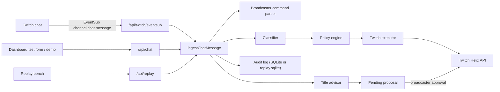

# Nachtschicht Architecture

Nachtschicht is a Twitch AI moderator. In chat it acts like a real moderator (warn, delete, timeout, ban, chat modes). Stream title, category, and tags are only **proposed** by the AI and published after broadcaster approval.

## Product invariants

These rules define the product. Any change that breaks one is a bug, not a feature.

1. The AI never calls Twitch directly. The classifier returns a structured verdict; only the policy engine (`lib/policy.ts`) decides the action, and only `lib/twitch.ts` executes it.
2. Title, category, and tags are never published without broadcaster approval (dashboard button or `!aimod approve` from the broadcaster).
3. Protected roles (default: moderator, broadcaster) are never punished automatically; they are only flagged.
4. Shadow mode and the emergency stop hold every action. Held decisions are still logged.
5. Unbans are human-only (dashboard or broadcaster command). The AI must not silently undo its own bans.
6. Every decision is written to the audit log with reason, confidence, model version, and rule version.
7. Chat text is untrusted input. It must never be able to change settings, issue commands, or alter the system prompt. Only messages whose sender is verified as broadcaster by Twitch user ID or badge may run `!aimod` commands.

## Stack

- Next.js 15 (App Router) with React 19, single app, Node.js runtime for all API routes.
- SQLite via `better-sqlite3`, file `data/nachtschicht.sqlite` (git-ignored).
- `zod` for request validation, `vitest` for tests.

## Data flow

The replay route binds `ingestChatMessage` to `data/replay.sqlite` through `runWithDatabase`. Shadow mode holds every action, so that run records the decision and does not call Helix.

## Module map

| Path | Responsibility |
| --- | --- |
| `lib/types.ts` | Shared domain types and enums (roles, risks, actions, settings, audit). |
| `lib/classifier.ts` | Turns a chat message into `Classification` (category, risk, confidence, reason). Currently heuristic (`heuristic-v2`). Identity slurs stay hate even when the message also contains an allowed term. |
| `lib/policy.ts` | Deterministic policy v3: moderation level plus streamer permissions map a verdict to an action. Also handles confidence thresholds, protected roles, shadow/emergency hold, escalation, and raid guard. |
| `lib/moderation.ts` | Orchestrates ingestion: classify, decide, execute, audit, title proposal. Builds the dashboard snapshot. |
| `lib/twitch.ts` | Twitch config, OAuth URL, action executor. |
| `lib/commands.ts` | Parses `!aimod <stop/start/shadow/live/approve/reject/unban login>`. |
| `lib/badges.ts` | Maps EventSub badges to `ChannelRole`. |
| `lib/eventsub.ts` | HMAC signature and timestamp check for EventSub webhooks. |
| `lib/crypto.ts` | AES-256-GCM encryption for stored OAuth tokens. |
| `lib/title-advisor.ts` | Detects topic shifts and creates title/category/tag proposals. |
| `lib/corpus.ts` | Labeled replay fixtures. `locked` cases are the current contract. `watch` cases record intended behavior the heuristic still misses. |
| `lib/replay.ts` | Runs the corpus through ingest on an isolated SQLite file in shadow mode. Refuses to reset the application database. |
| `lib/db.ts` | SQLite schema, migrations (`ensureColumn`), and all persistence. `runWithDatabase` binds a call to an explicit file. |
| `app/api/replay/route.ts` | Starts one replay against `data/replay.sqlite` and returns the report. |
| `lib/settings-input.ts` | Normalizes channel-setting edits: term lists, house rules, timeout bounds, and locked protected roles. |
| `app/api/*` | Thin route handlers: validate with zod, call `lib/*`, return JSON. |
| `app/layout.tsx`, `components/app-nav.tsx` | App shell: sidebar, type, and the desk / channel-settings navigation. |
| `components/dashboard.tsx` | Live desk: moderation shortcuts, AI runtime status, timeout details, test chat, replay bench, stream shield, proposals, audit. |
| `app/settings/page.tsx`, `components/settings-form.tsx` | Streamer channel setup: shadow or live, emergency stop, moderation level, permission ceiling, house rules, word lists, and protected roles. |

## Classifier boundary

The classifier returns a structured verdict. It does not call Twitch, and it does not receive tools.

MCP is a protocol for exposing tools to a model. Wiring moderation through an MCP server would give the model delete, timeout, ban, and chat-settings tools. The model could then skip `lib/policy.ts`: confidence thresholds, the permission ceiling, protected roles, shadow mode, the emergency stop, and the audit record. Those checks have to stay deterministic code.

A future LLM still returns `Classification` only, through a normal model API with a separated prompt. MCP is the wrong interface for that step. A later read-only MCP server could expose audit or proposal status to an operator assistant. It must not be the path that punishes chat.

## Policy summary

| Risk | Relaxed | Balanced | Strict |
| --- | --- | --- | --- |
| none | ignore | ignore | ignore |
| low | ignore | flag | delete |
| medium | flag | delete | timeout |
| high | delete | timeout | ban |
| severe | timeout | ban | ban |

The selected level proposes the action. Streamer permissions then enforce a ceiling:
ban falls back to timeout, timeout to delete, and delete to flag when the respective
permission is disabled. Protected roles are always only flagged. Shadow mode and
the emergency stop always hold actions.

Timeout duration grows with strikes (60 seconds doubling, capped by
`maxTimeoutSeconds`). A raid can request follower-only mode only when
`allowChatModeChanges` is enabled. Title proposals can be disabled independently
and still always require broadcaster approval before publication. The settings
API keeps `broadcaster` and `moderator` in `protectedRoles`.

## Persistence

Tables: `settings` (singleton), `stream_state` (singleton), `title_proposals`, `chat_messages`, `audit_log`, `oauth_states`, `twitch_account` (singleton, encrypted tokens), `eventsub_events` (deduplication by message ID).

The application file is `data/nachtschicht.sqlite` (`NACHTSCHICHT_DB_PATH` overrides it). The replay bench uses `data/replay.sqlite` and never resets the application file. Both match `data/*.sqlite` in `.gitignore`.

Schema changes go through `CREATE TABLE IF NOT EXISTS` plus `ensureColumn` so existing local databases keep working.

## Twitch integration

Scopes requested (see `getTwitchConfig`): `user:read:chat`, `user:write:chat`, `moderator:manage:chat_messages`, `moderator:manage:banned_users`, `moderator:manage:chat_settings`, `channel:manage:broadcast`.

Environment: see `.env.example` (`TWITCH_CLIENT_ID`, `TWITCH_CLIENT_SECRET`, `TWITCH_REDIRECT_URI`, `TWITCH_BOT_USER_ID`, planned `TOKEN_ENCRYPTION_KEY`, `EVENTSUB_SECRET`). Without credentials the app runs in demo mode and never contacts Twitch.

## Implementation status

Done:
- Heuristic classifier v2, policy engine v3, audit log, shadow mode, title proposals with approval, English dashboard, demo scenarios.
- Streamer controls for relaxed/balanced/strict moderation and individual delete, timeout, ban, chat-guard, and title-proposal permissions.
- Channel settings page for house rules, allowed and blocked terms, and protected roles. Broadcaster and moderator stay protected even if a request omits them.
- App shell with a persistent sidebar for the desk and channel settings.
- Dashboard AI runtime status and detailed timeout history. The heuristic uses no tokens; LLM context and token budget remain unavailable until an LLM provider is wired.
- Replay bench: labeled corpus, isolated `data/replay.sqlite`, shadow mode, dashboard panel, `npm run replay`.
- `getDashboard` returns `connection`.
- Helpers for commands, badges, EventSub signatures, token encryption, and the database tables for OAuth/EventSub.

In progress / not wired yet:
- OAuth callback (token exchange, `consumeOauthState`, `saveTwitchAccount`).
- Real Helix calls in `executeTwitchAction` (ban, delete, chat settings, modify channel information) with token refresh.
- `/api/twitch/eventsub` route using `verifyEventSubSignature`, `rememberEvent`, `roleFromBadges`.
- Broadcaster commands and strike counts wired into `ingestChatMessage`.
- Dashboard emergency stop and unban UI.

Planned:
- LLM classifier for uncertain cases with strict prompt separation.
- Data retention job and export/delete for GDPR.
