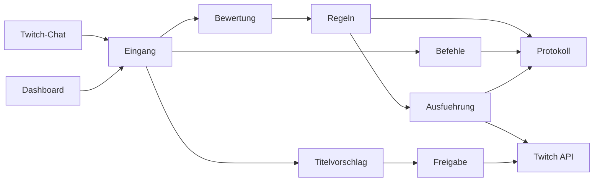

# Aufbau

Eine Next.js-15-App, kein Monorepo. SQLite in `data/nachtschicht.sqlite`. Dashboard auf Deutsch, Code und interne Doku auf Englisch. Zurück zur [[Nachtschicht|Startseite]].

Die KI liefert nur ein Urteil. Die Regeln entscheiden, Twitch wird danach aufgerufen. Die Stufen stehen in [[Moderationsstufen]], die Broadcaster-Befehle in [[Befehle]].

Twitch-Scopes: `user:read:chat`, `user:write:chat`, `moderator:manage:chat_messages`, `moderator:manage:banned_users`, `moderator:manage:chat_settings`, `channel:manage:broadcast`.

Was davon schon läuft, steht in [[Stand]].
